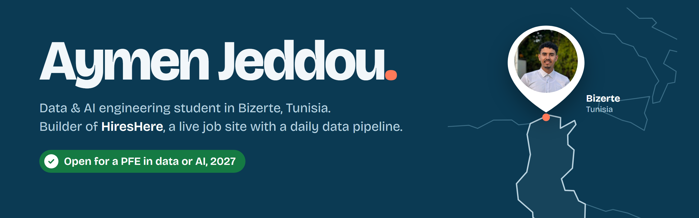

  
  
  
  
  
  

Third-year **Software & Data Engineering** student. I build data pipelines and AI systems, then measure whether they work: my latest is [HiresHere](https://hireshere.app), a live job site I run on a daily pipeline and an AI classifier. Looking for a **PFE internship in data or AI** for 2027.

  
  
  
  
  
  
  
  
  
  
  
  
  
  
  
  
  

