<a href="https://aymenjeddou.github.io"></a>

<p>
  <a href="https://aymenjeddou.github.io"></a>
  <a href="https://www.linkedin.com/in/aymen-jeddou-72891726a/"></a>
  <a href="mailto:aymenjeddou03@gmail.com"></a>
  <a href="https://aymenjeddou.github.io/assets/Aymen_Jeddou_CV_EN.pdf"></a>
</p>

I'm a third-year **Software & Data Engineering** student at the Faculty of Sciences of Bizerte, Tunisia.
I work on **RAG systems** and the **data pipelines** underneath them. I'm looking for a **PFE internship in data / AI** starting 2027.

```text
> what have you been working on?
route     → agent:about
retrieve  experience k=5
← hybrid retrieval, evaluation harnesses, and ETL pipelines
```

### What I've done recently

- **RAG Engineer & Scrum Master @ IDEALAB** (summer 2026): built a multi-agent RAG assistant for my faculty. I tracked weak retrieval down to a vector-index misconfiguration, then shipped hybrid search (pgvector + full-text, reciprocal rank fusion).
  **hit@5 0.50 → 0.90 · MRR 0.395 → 0.776**, measured with an evaluation harness I built for the team. CI with 69 tests, Docker, Alembic.
- **Now:** I own the RAG work-order agent in [RoadScan](https://aymenjeddou.github.io/#projects), which turns a citizen's pothole photo into a cited repair order routed to the right authority.
- **Direction:** data engineering. Every RAG bug I've fixed turned out to be a data bug.

### Selected work

| Project | What it is | Stack |
|---|---|---|
| [**FSB Nexus**](https://github.com/AymenJeddou/digital_campus_platform) | Multi-agent academic assistant with hybrid retrieval + citations | FastAPI · pgvector · Mistral · Alembic |
| **Mobility & Environment ETL** | Airflow DAG over 7 public datasets → staged, cleaned, quality-checked, loaded to Postgres | Airflow · pandas · PostgreSQL · Docker |
| [**FSBridge**](https://github.com/AymenJeddou/FSBridge) | Student portal with GPA engine and a Gemini assistant | React · TypeScript · Supabase |
| [**AgroScan**](https://github.com/AymenJeddou/AgroScan) | Photo → one of 40 crop pests identified, with treatment advice (FR/EN/AR) | Flutter · Gemini · SQLite |
| [**Smart Olive Grove**](https://github.com/AymenJeddou/OliveGrove_IOT) | Live Arduino sensor stream + Random Forest tree-health model | Arduino · scikit-learn · Express |

<sub>More on the <a href="https://aymenjeddou.github.io/#projects">portfolio</a>.</sub>

### Toolbox

<p>
  
  
  
  
  
  
  
  
  
  
  
  
  
  
</p>

<sub>Arabic (native) · French (bilingual) · English (C1) · Bizerte, Tunisia</sub>
